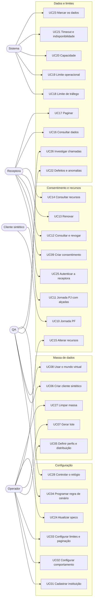

# Casos de Uso

Relacionados: [regras de negócio](../regras-de-negocio.md) · [requisitos](../requisitos.md) · [personas](../../00-visao-geral/personas.md) · [glossário](../glossario.md) · [cenários Gherkin](../gherkin/)

## Atores
| Ator | Descrição |
|---|---|
| **Operador** | Mantém bancos, configuração e massa (Diego). |
| **QA** | Monta cenários e confere resultados (Bruno). |
| **Desenvolvedor** | Integra a receptora contra o simulador (Ana). |
| **Analista** | Valida regras e demonstra a jornada (Carla). |
| **Receptora** | Sistema que chama as APIs. Ex.: o coletor. |
| **Cliente sintético** | Pessoa fictícia que faz a jornada de consentimento. |
| **Sistema** | Processos automáticos: expiração, geração e limites. |

## Diagrama

## Status dos casos de uso
| Status | Significado |
|---|---|
| **Rascunho** | Escrito, ainda não revisado pela equipe. |
| **Em revisão** | Sendo validado; pode ter pontos em aberto. |
| **Aprovado** | Revisado ponto a ponto, sem perguntas em aberto. Pronto para virar spec. |

Todos começam como **Rascunho**.

## Configuração

### UC01 — Cadastrar instituição simulada
- **Status:** Aprovado
- **Ator:** Operador
- **Objetivo:** criar um banco com endereço próprio, pronto para responder.
- **Campos obrigatórios:** nome ([registro](../campos-obrigatorios.md)).
- **Fluxo principal:** 1. Informa o nome e escolhe um perfil de comportamento. 2. Opcionalmente ajusta público, produtos e marca. 3. O sistema gera `organisationId` e endereço e publica a instituição.
- **Fluxo alternativo — banco com nome real:** informa o banco real, e o sistema aplica o prefixo do ambiente, como `HML-Itaú` ([RN09](../regras-de-negocio.md#rn09)).
- **Fluxo alternativo — usar banco pronto:** os bancos de perfil e os de nome real já existem ao subir o ambiente ([RN02](../regras-de-negocio.md#rn02)).
- **Fluxo alternativo — inativar:** instituição com clientes é inativada e responde como fora do ar ([RN06](../regras-de-negocio.md#rn06)).
- **Exceções:** nome repetido → recusado.
- **Pós-condição:** vale na próxima chamada, com histórico ([RN05](../regras-de-negocio.md#rn05)).
- **Regras:** [RN01](../regras-de-negocio.md#rn01) a [RN09](../regras-de-negocio.md#rn09).
- **Exemplo:** Diego cria o "Banco Azul" com o perfil `lento` e, no dia seguinte, reduz a lentidão só nesse banco.

### UC02 — Configurar comportamento
- **Status:** Em revisão
- **Ator:** Operador
- **Objetivo:** dizer como a instituição responde.
- **Fluxo principal:** 1. Abre a instituição. 2. Ajusta latência por classe de frequência, taxa de erro e pesos por status. 3. A tela compara com o SLA oficial ([UI04](../interface.md#ui04)). 4. Salva.
- **Exceções:** taxa fora de 0 a 100% → recusado; status que a spec não declara → recusado ([RN13](../regras-de-negocio.md#rn13)).
- **Regras:** [RN04](../regras-de-negocio.md#rn04), [RN05](../regras-de-negocio.md#rn05), [RN10](../regras-de-negocio.md#rn10) a [RN13](../regras-de-negocio.md#rn13).
- **Observação:** sem telemetria real, os valores dos perfis são estimativas ([PA20](../regras-de-negocio.md#pa20)).

### UC03 — Configurar limites e paginação
- **Status:** Rascunho
- **Ator:** Operador
- **Objetivo:** definir TPM, limite operacional, capacidade e paginação da instituição.
- **Fluxo principal:** 1. Vê os valores oficiais já preenchidos. 2. Informa o QCA de cada receptora. 3. Liga ou desliga o limite operacional. 4. Ajusta TPS, `page-size` máximo e validade da chave. 5. Salva.
- **Fluxo alternativo — valor abaixo do oficial:** o sistema avisa e, confirmado, registra uma anomalia ([RN113](../regras-de-negocio.md#rn113)).
- **Regras:** [RN20](../regras-de-negocio.md#rn20) a [RN32](../regras-de-negocio.md#rn32).

### UC04 — Programar regra de cenário
- **Status:** Rascunho
- **Ator:** QA
- **Objetivo:** provocar uma situação específica, de forma repetível.
- **Fluxo principal:** 1. Escolhe o alcance: instituição, endpoint, cliente ou recurso. 2. Escolhe o efeito: latência, status, timeout, indisponibilidade, defeito ou mudança de estado. 3. Define frequência, período e semente. 4. Salva.
- **Fluxo alternativo — pacote de cenário:** salva várias regras com um nome e liga tudo de uma vez.
- **Pós-condição:** a regra mais específica vence, e o registro de chamada mostra qual agiu ([RN15](../regras-de-negocio.md#rn15)).
- **Regras:** [RN14](../regras-de-negocio.md#rn14) a [RN18](../regras-de-negocio.md#rn18), [RN54](../regras-de-negocio.md#rn54).
- **Exemplo:** Bruno faz "Mariana sempre recebe 504 em saldos" e roda o mesmo teste todo dia.

### UC24 — Atualizar specs
- **Status:** Rascunho
- **Ator:** Operador
- **Objetivo:** adotar uma nova versão oficial.
- **Fluxo principal:** 1. Atualiza o commit fixado de `open-finance-specs`. 2. O sistema confere os hashes. 3. Mostra operações novas, alteradas e removidas. 4. Publica a nova versão.
- **Exceções:** hash divergente → recusado.
- **Regras:** [PR06](../../00-visao-geral/premissas.md#pr06), [ADR-002](../../05-adr/ADR-002-specs-fixadas-por-commit.md).

### UC28 — Controlar o relógio
- **Status:** Rascunho
- **Ator:** QA
- **Objetivo:** testar o que depende de tempo sem esperar: 60 minutos do consentimento, virada do mês.
- **Fluxo principal:** 1. Escolhe a instituição. 2. Fixa uma data ou define um fator de aceleração. 3. As respostas passam a usar a hora simulada, e o cabeçalho `x-sim-clock` a mostra.
- **Regras:** [RN73](../regras-de-negocio.md#rn73).

## Massa de dados

### UC05 — Definir perfis de dados e distribuição
- **Status:** Rascunho
- **Ator:** Operador
- **Objetivo:** dizer como é a massa.
- **Fluxo principal:** 1. Escolhe ou cria um perfil de dados. 2. Define a distribuição entre instituições, produtos e perfis. 3. O sistema confere as somas.
- **Exceções:** soma diferente de 100% → recusado ([RN56](../regras-de-negocio.md#rn56)); perfil em uso → não pode ser apagado.
- **Regras:** [RN55](../regras-de-negocio.md#rn55), [RN56](../regras-de-negocio.md#rn56).

### UC06 — Criar cliente sintético
- **Status:** Rascunho
- **Ator:** QA ou Desenvolvedor
- **Objetivo:** ter um cliente específico para um teste.
- **Fluxo principal:** 1. Escolhe a instituição, o tipo (PF ou PJ) e o perfil de dados. 2. O sistema gera documento válido, nome e produtos. 3. Mostra os dados de login para a jornada.
- **Fluxo alternativo — já autorizado:** marca "criar consentimento autorizado" para pular a jornada.
- **Regras:** [RN51](../regras-de-negocio.md#rn51), [RN54](../regras-de-negocio.md#rn54), [RN57](../regras-de-negocio.md#rn57), [RN60](../regras-de-negocio.md#rn60).

### UC07 — Gerar lote
- **Status:** Rascunho
- **Ator:** Operador
- **Objetivo:** criar N clientes com consentimentos e recursos, para testes e demonstrações.
- **Fluxo principal:** 1. Informa quantidade, distribuição, permissões e semente. 2. Acompanha o progresso em segundo plano. 3. Recebe o resumo.
- **Fluxo alternativo — cancelar:** para e mantém o que já foi criado, marcado como parcial.
- **Pós-condição:** consentimentos já nascem `AUTHORISED`; é um atalho de teste, identificado no lote.
- **Regras:** [RN51](../regras-de-negocio.md#rn51), [RN56](../regras-de-negocio.md#rn56), [RN58](../regras-de-negocio.md#rn58).

### UC08 — Usar o mundo virtual
- **Status:** Rascunho
- **Ator:** QA
- **Objetivo:** testar carga com milhões de itens, sem gravar nada.
- **Fluxo principal:** 1. Define total e semente. 2. Pede uma faixa de itens por uma API de administração. 3. Usa os IDs nas APIs.
- **Fluxo alternativo — ajuste:** revoga um consentimento virtual, e o ajuste passa a valer ([RN53](../regras-de-negocio.md#rn53)).
- **Regras:** [RN52](../regras-de-negocio.md#rn52) a [RN54](../regras-de-negocio.md#rn54), [RN62](../regras-de-negocio.md#rn62).

### UC27 — Limpar massa
- **Status:** Rascunho
- **Ator:** Operador
- **Fluxo principal:** 1. Escolhe um lote, uma instituição ou tudo. 2. Vê o que será apagado. 3. Confirma.
- **Exceções:** instituições e perfis prontos não são apagados.
- **Regras:** [RN58](../regras-de-negocio.md#rn58), [RN71](../regras-de-negocio.md#rn71).

## Consentimento e recursos

### UC25 — Autenticar a receptora
- **Status:** Rascunho
- **Ator:** Receptora
- **Objetivo:** obter acesso do mesmo jeito que em uma instituição real.
- **Fluxo principal (modo FAPI):** 1. Registra-se por DCR. 2. Usa `client_credentials` para criar o consentimento. 3. Envia o pedido por PAR, com PKCE. 4. Depois da jornada, troca o código por token vinculado ao consentimento.
- **Fluxo alternativo — modo simples:** usa um token emitido por API própria do simulador, ligado a receptora e consentimento.
- **Exceções:** certificado, cliente, escopo ou redirect inválidos → recusado.
- **Regras:** [RN120](../regras-de-negocio.md#rn120) a [RN123](../regras-de-negocio.md#rn123).

### UC09 — Criar consentimento
- **Status:** Rascunho
- **Ator:** Receptora
- **Fluxo principal:** 1. Chama `POST /consents` com usuário, permissões e validade. 2. O sistema valida grupos e tipo de pessoa. 3. Cria em `AWAITING_AUTHORISATION` e responde 201.
- **Exceções:** erros 422 de [RN83](../regras-de-negocio.md#rn83) e [RN84](../regras-de-negocio.md#rn84).
- **Pós-condição:** sem aprovação em 60 minutos, vai para `REJECTED` ([RN81](../regras-de-negocio.md#rn81)).
- **Regras:** [RN08](../regras-de-negocio.md#rn08), [RN80](../regras-de-negocio.md#rn80) a [RN85](../regras-de-negocio.md#rn85).

### UC10 — Fazer a jornada de consentimento (PF)
- **Status:** Rascunho
- **Ator:** Cliente sintético
- **Pré-condição:** consentimento em `AWAITING_AUTHORISATION` ([UC09](#uc09)).
- **Fluxo principal:** 1. **Consentimento:** na receptora, o cliente escolhe banco, dados e prazo. 2. **Direcionamento:** tela de transição. 3. **Autenticação:** login no banco simulado e conferência de titularidade. 4. **Confirmação:** vê destinatário, prazo e dados, escolhe contas e cartões e confirma. 5. **Redirecionamento:** tela de transição de volta. 6. **Efetivação:** a receptora mostra o resultado.
- **Fluxo alternativo — sem receptora própria:** a receptora de demonstração faz as etapas 1, 2 e 6 ([RN91](../regras-de-negocio.md#rn91)).
- **Fluxos de exceção:** titular diferente → interrompe ([RN93](../regras-de-negocio.md#rn93)); cliente cancela → `REJECTED` ([RN96](../regras-de-negocio.md#rn96)); falha no login ou fora do ar → consentimento segue pendente e pode ser retomado em até 60 minutos ([RN81](../regras-de-negocio.md#rn81)).
- **Pós-condição:** `AUTHORISED`, com recursos selecionados.
- **Regras:** [RN90](../regras-de-negocio.md#rn90) a [RN97](../regras-de-negocio.md#rn97), [RN99](../regras-de-negocio.md#rn99).

### UC11 — Fazer a jornada com múltiplas alçadas (PJ)
- **Status:** Rascunho
- **Ator:** Cliente sintético (representante da empresa)
- **Fluxo principal:** 1. Helena faz a jornada da Indústria Aurora. 2. O consentimento fica `AUTHORISED`, e os recursos, `PENDING_AUTHORISATION`. 3. Paula aprova na tela da instituição. 4. Os recursos vão para `AVAILABLE`.
- **Fluxo alternativo — recusa:** um aprovador recusa, e os recursos vão para `UNAVAILABLE`.
- **Fluxo alternativo — prazo:** sem aprovação no prazo, os recursos não ficam disponíveis.
- **Fluxo alternativo — sócio único:** Comércio Sol aprova sem etapa extra.
- **Regras:** [RN98](../regras-de-negocio.md#rn98), [RN107](../regras-de-negocio.md#rn107).

### UC12 — Consultar e revogar consentimento
- **Status:** Rascunho
- **Ator:** Receptora ou Cliente sintético
- **Fluxo principal:** 1. A receptora consulta `GET /consents/{consentId}`. 2. Revoga por `DELETE`, ou o cliente revoga na tela de gestão do banco. 3. Vai para `REJECTED`, com quem rejeitou.
- **Pós-condição:** as APIs passam a responder 401 ([RN88](../regras-de-negocio.md#rn88)).
- **Regras:** [RN82](../regras-de-negocio.md#rn82), [RN86](../regras-de-negocio.md#rn86), [RN88](../regras-de-negocio.md#rn88).

### UC13 — Renovar consentimento
- **Status:** Rascunho
- **Ator:** Receptora
- **Fluxo principal:** 1. Chama `POST /consents/{consentId}/extends` com a nova validade. 2. O sistema valida estado, data e documento. 3. Registra a extensão, consultável em `/extensions`.
- **Exceções:** erros 422 de [RN87](../regras-de-negocio.md#rn87).
- **Regras:** [RN87](../regras-de-negocio.md#rn87).

### UC14 — Consultar recursos
- **Status:** Rascunho
- **Ator:** Receptora
- **Fluxo principal:** 1. Chama `GET /resources`. 2. Recebe os recursos com tipo e estado.
- **Fluxo alternativo — preparando:** 202 sem corpo, enquanto a instituição prepara, até 5 minutos; depois, 504 ([RN103](../regras-de-negocio.md#rn103)).
- **Fluxo alternativo — sem recursos:** 200 com lista vazia ([RN102](../regras-de-negocio.md#rn102)).
- **Regras:** [RN47](../regras-de-negocio.md#rn47), [RN100](../regras-de-negocio.md#rn100) a [RN107](../regras-de-negocio.md#rn107).

### UC15 — Alterar recursos
- **Status:** Rascunho
- **Ator:** Operador ou QA
- **Objetivo:** simular bloqueio, encerramento ou produto novo.
- **Fluxo principal:** 1. Abre o recurso. 2. Muda o estado ou adiciona um produto. 3. Vale na próxima chamada.
- **Exceções:** transição proibida → recusado, salvo anomalia ([RN101](../regras-de-negocio.md#rn101)).
- **Regras:** [RN101](../regras-de-negocio.md#rn101), [RN106](../regras-de-negocio.md#rn106), [RN108](../regras-de-negocio.md#rn108).

## Dados e limites

### UC16 — Consultar dados
- **Status:** Rascunho
- **Ator:** Receptora
- **Fluxo principal:** 1. Chama um endpoint de dados. 2. O sistema valida cabeçalhos, token e permissão. 3. Aplica capacidade, tráfego, parâmetros, limite e cenário. 4. Responde com dado coerente e marcado.
- **Exceções:** ver a tabela de [comportamento por estado](../regras-de-negocio.md#consentimento) e [RN104](../regras-de-negocio.md#rn104).
- **Regras:** [RN38](../regras-de-negocio.md#rn38) a [RN47](../regras-de-negocio.md#rn47).

### UC17 — Paginar
- **Status:** Rascunho
- **Ator:** Receptora
- **Fluxo principal:** 1. Pede a primeira página. 2. Recebe `links.next` com a chave. 3. Segue até a última página.
- **Fluxo alternativo — chave inválida ou expirada:** recebe nova chave, com sucesso, e a chamada conta na cota ([RN36](../regras-de-negocio.md#rn36)).
- **Regras:** [RN31](../regras-de-negocio.md#rn31) a [RN37](../regras-de-negocio.md#rn37).

### UC18 — Aplicar limite de tráfego
- **Status:** Rascunho
- **Ator:** Sistema
- **Fluxo principal:** 1. Conta a chamada no minuto cheio, por endpoint e receptora. 2. Passou do TPM: responde 429.
- **Regras:** [RN20](../regras-de-negocio.md#rn20) a [RN24](../regras-de-negocio.md#rn24), [RN30](../regras-de-negocio.md#rn30).

### UC19 — Aplicar limite operacional
- **Status:** Rascunho
- **Ator:** Sistema
- **Fluxo principal:** 1. Confere a cota do mês, por endpoint, objeto, cliente e receptora. 2. Passou: responde 423. 3. Depois de uma resposta 2XX que não seja de página seguinte, conta a chamada.
- **Regras:** [RN25](../regras-de-negocio.md#rn25) a [RN28](../regras-de-negocio.md#rn28).

### UC20 — Aplicar capacidade
- **Status:** Rascunho
- **Ator:** Sistema
- **Fluxo principal:** 1. Conta as requisições por segundo da instituição. 2. Passou da capacidade configurada: responde 529.
- **Regras:** [RN29](../regras-de-negocio.md#rn29), [RN30](../regras-de-negocio.md#rn30).

### UC21 — Simular timeout e indisponibilidade
- **Status:** Rascunho
- **Ator:** Sistema
- **Fluxo principal:** 1. O perfil ou uma regra de cenário afeta a chamada. 2. O sistema segura a resposta pelo tempo configurado. 3. No perfil `timeout`, termina em 504. Regras de cenário podem simular 503, conexão cortada ou corpo truncado.
- **Regras:** [RN12](../regras-de-negocio.md#rn12), [RN16](../regras-de-negocio.md#rn16), [RN17](../regras-de-negocio.md#rn17).

### UC22 — Injetar defeitos e anomalias
- **Status:** Rascunho
- **Ator:** QA
- **Objetivo:** ver como a receptora reage a dado ruim e a desvio de protocolo. O simulador não valida o resultado ([PR04](../../00-visao-geral/premissas.md#pr04)).
- **Fluxo principal:** 1. Escolhe no catálogo um defeito ou anomalia. 2. Define alcance e taxa. 3. Confere nos registros de chamada onde foi aplicado.
- **Regras:** [RN110](../regras-de-negocio.md#rn110) a [RN115](../regras-de-negocio.md#rn115).

### UC23 — Marcar os dados
- **Status:** Rascunho
- **Ator:** Sistema
- **Fluxo principal:** 1. Na criação, grava ambiente e natureza. 2. Aplica o prefixo nos IDs e a marca nos campos livres. 3. Em cada resposta, envia os cabeçalhos.
- **Regras:** [RN60](../regras-de-negocio.md#rn60) a [RN66](../regras-de-negocio.md#rn66), [RN70](../regras-de-negocio.md#rn70).

### UC26 — Investigar chamadas
- **Status:** Rascunho
- **Ator:** QA ou Desenvolvedor
- **Fluxo principal:** 1. Busca por `x-fapi-interaction-id`, instituição, cliente ou período. 2. Vê status, tempo, regra aplicada, defeito e anomalia.
- **Regras:** [RN18](../regras-de-negocio.md#rn18), [RN74](../regras-de-negocio.md#rn74), [RN112](../regras-de-negocio.md#rn112).
