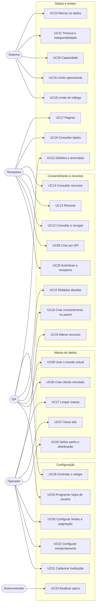

# Casos de Uso

Relacionados: [regras de negócio](../regras-de-negocio.md) · [requisitos](../requisitos.md) · [personas](../../00-visao-geral/personas.md) · [glossário](../glossario.md) · [cenários Gherkin](../gherkin/)

## Atores
| Ator | Descrição |
|---|---|
| **Operador** | Mantém bancos, configuração e massa (Diego). |
| **QA** | Monta cenários e confere resultados (Bruno). |
| **Desenvolvedor** | Integra a receptora contra o simulador (Ana). |
| **Analista** | Valida regras e cria consentimentos para demonstrar (Carla). |
| **Receptora** | Sistema que chama as APIs. Ex.: o coletor. |
| **Sistema** | Processos automáticos: expiração, geração e limites. |

## Diagrama

## Status dos casos de uso
| Status | Significado |
|---|---|
| **Rascunho** | Escrito, ainda não revisado pela equipe. |
| **Em revisão** | Sendo validado; pode ter pontos em aberto. |
| **Aprovado** | Revisado ponto a ponto, sem perguntas em aberto. Pronto para virar spec. |
| **Adiado** | Fora desta versão. |
| **Removido** | Decidido que não faz parte do simulador. |

Todos começam como **Rascunho**.

## Configuração

### UC01 — Cadastrar instituição simulada
- **Status:** Aprovado
- **Ator:** Operador
- **Objetivo:** criar um banco com endereço próprio, pronto para responder.
- **Campos obrigatórios:** nome ([registro](../campos-obrigatorios.md)).
- **Fluxo principal:** 1. Informa o nome e escolhe um perfil de comportamento. 2. Opcionalmente ajusta público, produtos e marca. 3. O sistema gera `organisationId` e endereço e publica a instituição.
- **Fluxo alternativo — banco com nome real:** informa o banco real, e o sistema aplica o prefixo do ambiente, como `HML-Itaú` ([RN09](../regras-de-negocio.md#rn09)).
- **Fluxo alternativo — usar banco pronto:** os bancos de perfil e os de nome real já existem ao subir o ambiente ([RN02](../regras-de-negocio.md#rn02)).
- **Fluxo alternativo — inativar:** instituição com clientes é inativada e responde como fora do ar. Instituição inativa pode ser reativada ([RN06](../regras-de-negocio.md#rn06)).
- **Exceções:** nome repetido → recusado.
- **Pós-condição:** vale na próxima chamada, com histórico ([RN05](../regras-de-negocio.md#rn05)).
- **Regras:** [RN01](../regras-de-negocio.md#rn01) a [RN09](../regras-de-negocio.md#rn09).
- **Exemplo:** Diego cria o "Banco Azul" com o perfil `lento` e, no dia seguinte, reduz a lentidão só nesse banco.

### UC02 — Configurar comportamento
- **Status:** Aprovado
- **Ator:** Operador
- **Objetivo:** dizer como a instituição responde.
- **Fluxo principal:** 1. Abre a instituição. 2. Ajusta latência por classe de frequência, taxa de erro e pesos por status. 3. A tela compara com o SLA oficial ([UI04](../interface.md#ui04)). 4. Salva.
- **Exceções:** taxa fora de 0 a 100% → recusado; status que nenhuma spec declara, ou 429, 423 e 529 → recusado ([RN13](../regras-de-negocio.md#rn13)).
- **Regras:** [RN04](../regras-de-negocio.md#rn04), [RN05](../regras-de-negocio.md#rn05), [RN10](../regras-de-negocio.md#rn10) a [RN13](../regras-de-negocio.md#rn13).
- **Observação:** sem telemetria real, os valores dos perfis são estimativas ([PA20](../regras-de-negocio.md#pa20)).

### UC03 — Configurar limites e paginação
- **Status:** Aprovado
- **Ator:** Operador
- **Objetivo:** definir TPM, limite operacional, capacidade e paginação da instituição.
- **Fluxo principal:** 1. Vê os valores oficiais já preenchidos. 2. Informa o QCA do banco, que vale para toda receptora. 3. Liga ou desliga o limite operacional. 4. Ajusta TPS, `page-size` máximo e validade da chave. 5. Salva.
- **Fluxo alternativo — QCA por receptora:** sobrescreve o valor do banco para uma receptora ([RN21](../regras-de-negocio.md#rn21)).
- **Fluxo alternativo — valor diferente do oficial:** o sistema aceita e avisa na tela quando fica abaixo do oficial ([RN26](../regras-de-negocio.md#rn26)).
- **Regras:** [RN20](../regras-de-negocio.md#rn20) a [RN37](../regras-de-negocio.md#rn37).

### UC04 — Programar regra de cenário
- **Status:** Aprovado
- **Ator:** QA
- **Objetivo:** provocar uma situação específica, de forma repetível.
- **Fluxo principal:** 1. Escolhe o alcance: instituição, endpoint, cliente, recurso ou uma combinação deles. 2. Escolhe o efeito: latência, status, timeout, indisponibilidade, falha de transporte, defeito (spec 009) ou mudança de estado. 3. Define frequência, período e semente. 4. Salva.
- **Fluxo alternativo — pacote de cenário:** salva várias regras com um nome e liga tudo de uma vez ([RN19](../regras-de-negocio.md#rn19)).
- **Pós-condição:** a regra mais específica vence ([RN15](../regras-de-negocio.md#rn15)).
- **Regras:** [RN13](../regras-de-negocio.md#rn13) a [RN19](../regras-de-negocio.md#rn19), [RN54](../regras-de-negocio.md#rn54).
- **Exemplo:** Bruno faz "Mariana sempre recebe 504 em saldos" e roda o mesmo teste todo dia.

### UC24 — Atualizar specs
- **Status:** Aprovado
- **Ator:** Desenvolvedor
- **Objetivo:** adotar uma nova versão oficial.
- **Fluxo principal:** 1. Muda o commit em `specs.lock.json` e abre um PR. 2. O CI confere os hashes. 3. O CI mostra operações novas, alteradas e removidas. 4. Com o PR aprovado, o deploy publica a nova imagem. Não há tela para isso.
- **Exceções:** hash divergente → o build falha.
- **Regras:** [PR06](../../00-visao-geral/premissas.md#pr06), [ADR-002](../../05-adr/ADR-002-specs-fixadas-por-commit.md).

### UC28 — Controlar o relógio
- **Status:** Aprovado
- **Ator:** QA
- **Objetivo:** testar o que depende de tempo sem esperar: validade do token, da chave de paginação e virada do mês.
- **Fluxo principal:** 1. Escolhe a instituição. 2. Fixa uma data ou define um fator de aceleração. 3. As respostas passam a usar a hora simulada, e o cabeçalho `x-sim-clock` a mostra.
- **Fluxo alternativo — voltar ao normal:** volta ao relógio real.
- **Pós-condição:** TPM e capacidade seguem a hora real ([RN73](../regras-de-negocio.md#rn73)).
- **Regras:** [RN73](../regras-de-negocio.md#rn73).

## Massa de dados

### UC05 — Definir perfis de dados e distribuição
- **Status:** Aprovado
- **Ator:** Operador
- **Objetivo:** dizer como é a massa.
- **Fluxo principal:** 1. Escolhe ou cria um perfil de dados. 2. Define a divisão dos consentimentos entre bancos, a divisão dos clientes entre perfis e a porcentagem de cada produto. 3. O sistema confere as somas de bancos e perfis.
- **Exceções:** soma de bancos ou perfis diferente de 100% → recusado ([RN56](../regras-de-negocio.md#rn56)); perfil em uso → não pode ser apagado.
- **Regras:** [RN55](../regras-de-negocio.md#rn55), [RN56](../regras-de-negocio.md#rn56).

### UC06 — Criar cliente simulado
- **Status:** Aprovado
- **Ator:** QA ou Desenvolvedor
- **Objetivo:** ter um cliente específico para um teste.
- **Fluxo principal:** 1. Escolhe o tipo (PF ou PJ), o perfil de dados e os bancos onde o cliente tem produtos. 2. O sistema gera documento válido, nome e produtos em cada banco. O nome pode ser informado; o documento é sempre gerado. 3. Mostra o cliente criado.
- **Fluxo alternativo — consentimento:** segue para o [UC10](#uc10). O mesmo cliente pode ter outro consentimento no mesmo banco ou em outro ([RN49](../regras-de-negocio.md#rn49)).
- **Regras:** [RN49](../regras-de-negocio.md#rn49), [RN51](../regras-de-negocio.md#rn51), [RN54](../regras-de-negocio.md#rn54), [RN57](../regras-de-negocio.md#rn57), [RN60](../regras-de-negocio.md#rn60).

### UC07 — Gerar lote
- **Status:** Aprovado
- **Ator:** Operador
- **Objetivo:** criar N clientes com consentimentos e recursos, para testes e demonstrações.
- **Fluxo principal:** 1. Informa quantidade, distribuição (com a porcentagem de PJ), consentimentos por cliente, permissões e semente. 2. Acompanha o progresso em segundo plano. 3. Recebe o resumo.
- **Fluxo alternativo — cancelar:** para e mantém o que já foi criado, marcado como parcial.
- **Fluxo alternativo — semente repetida:** gera normalmente, com outros documentos e IDs ([RN54](../regras-de-negocio.md#rn54)).
- **Pós-condição:** consentimentos nascem `AUTHORISED` ([RN80](../regras-de-negocio.md#rn80)).
- **Regras:** [RN51](../regras-de-negocio.md#rn51), [RN56](../regras-de-negocio.md#rn56), [RN58](../regras-de-negocio.md#rn58).

### UC08 — Usar o mundo virtual
- **Status:** Aprovado
- **Ator:** QA
- **Objetivo:** testar carga com milhões de itens, sem gravar os itens.
- **Fluxo principal:** 1. Define total, semente e distribuição entre os bancos, que ficam gravados. 2. Pede uma faixa de itens por uma API de administração. 3. Usa os IDs nas APIs.
- **Fluxo alternativo — ajuste:** revoga um consentimento virtual, e o ajuste passa a valer ([RN53](../regras-de-negocio.md#rn53)).
- **Fluxo alternativo — ajustar transação:** muda um valor por uma API de administração, e o ajuste passa a valer ([RN53](../regras-de-negocio.md#rn53)).
- **Fluxo alternativo — trocar a semente ou a distribuição:** o sistema avisa e, confirmado, apaga os ajustes do mundo virtual.
- **Fluxo alternativo — mudar o total:** os ajustes ficam, e os de itens fora do novo total deixam de ter efeito.
- **Regras:** [RN52](../regras-de-negocio.md#rn52) a [RN54](../regras-de-negocio.md#rn54), [RN62](../regras-de-negocio.md#rn62).

### UC27 — Limpar massa
- **Status:** Aprovado
- **Ator:** Operador
- **Fluxo principal:** 1. Escolhe um lote, uma instituição, os ajustes do mundo virtual ou tudo. 2. Vê o que será apagado. 3. Confirma.
- **Alcance por instituição:** apaga consentimentos e recursos daquele banco, e o cliente só se ele não tiver produto em outro banco. A instituição continua existindo.
- **Alcance de "tudo":** apaga massa, lotes, ajustes e as instituições e perfis criados pelo operador, exceto os que o mundo virtual usa. A definição do mundo virtual fica.
- **Exceções:** instituições e perfis prontos não são apagados.
- **Regras:** [RN53](../regras-de-negocio.md#rn53), [RN58](../regras-de-negocio.md#rn58), [RN71](../regras-de-negocio.md#rn71).

## Consentimento e recursos

### UC25 — Autenticar a receptora
- **Status:** Aprovado
- **Ator:** Receptora
- **Objetivo:** identificar quem chama o simulador, porque cada receptora tem seus limites.
- **Pré-condição:** o operador cadastrou a receptora com nome e `organisationId`, e o simulador gerou usuário e senha de teste.
- **Fluxo principal:** 1. A receptora envia usuário, senha e `scope=consent:{consentId}`. 2. O simulador devolve um token ligado à receptora e ao consentimento. 3. A receptora usa o token em Recursos, nas APIs de produto e na renovação.
- **Fluxo alternativo — token da receptora:** com `scope=consents`, recebe um token sem consentimento, usado para criar, consultar e revogar consentimentos.
- **Exceções:** credencial inválida, ou token de consentimento pedido para um que não esteja `AUTHORISED` ou que seja de outra receptora → recusado.
- **Regras:** [RN120](../regras-de-negocio.md#rn120), [RN122](../regras-de-negocio.md#rn122), [RN123](../regras-de-negocio.md#rn123).

### UC09 — Criar consentimento por API
- **Status:** Aprovado
- **Ator:** Receptora
- **Fluxo principal:** 1. Chama `POST /consents` com usuário, permissões e validade. 2. O sistema valida grupos e tipo de pessoa. 3. Cria em `AUTHORISED`, com os produtos do cliente naquele banco, e responde 201.
- **Diferença do processo oficial:** em um banco real, a resposta traz `AWAITING_AUTHORISATION`, e o cliente autoriza depois. Aqui a receptora segue direto para o token ([RN80](../regras-de-negocio.md#rn80)).
- **Exceções:** erros 422 de [RN83](../regras-de-negocio.md#rn83) e [RN84](../regras-de-negocio.md#rn84); documento que não é de cliente simulado → 422 `ERRO_NAO_MAPEADO` ([RN80](../regras-de-negocio.md#rn80)).
- **Regras:** [RN08](../regras-de-negocio.md#rn08), [RN80](../regras-de-negocio.md#rn80), [RN82](../regras-de-negocio.md#rn82) a [RN85](../regras-de-negocio.md#rn85).

### UC10 — Criar consentimento no painel
- **Status:** Aprovado
- **Ator:** QA, Desenvolvedor ou Analista, já autenticado no sistema
- **Objetivo:** criar um consentimento por um menu, sem login no banco.
- **Pré-condição:** cliente simulado com produto na instituição ([UC06](#uc06)).
- **Fluxo principal:** 1. Escolhe o cliente. 2. Escolhe a instituição e a receptora. 3. Escolhe as permissões, as contas e os cartões, e o prazo. 4. Confirma, e o consentimento nasce `AUTHORISED`.
- **Exceções:** combinação de permissões inválida ou nenhuma origem selecionada → a tela não deixa confirmar.
- **Regras:** [RN08](../regras-de-negocio.md#rn08), [RN49](../regras-de-negocio.md#rn49), [RN80](../regras-de-negocio.md#rn80), [RN83](../regras-de-negocio.md#rn83) a [RN85](../regras-de-negocio.md#rn85), [RN95](../regras-de-negocio.md#rn95).

### UC11 — Múltiplas alçadas (PJ)
- **Status:** Aprovado
- **Ator:** QA, Desenvolvedor ou Analista
- **Fluxo principal:** 1. Ao criar o consentimento da Indústria Aurora, marca "exige múltiplas alçadas" e informa quantas aprovações faltam. 2. O consentimento fica `AUTHORISED`, e os recursos, `PENDING_AUTHORISATION`. 3. Aprova no painel quantas vezes for preciso. 4. Os recursos vão para `AVAILABLE`.
- **Fluxo alternativo — recusa:** recusa no painel, e os recursos vão para `UNAVAILABLE`.
- **Fluxo alternativo — prazo:** sem aprovação em até 15 dias, os recursos vão para `UNAVAILABLE`.
- **Regras:** [RN98](../regras-de-negocio.md#rn98), [RN107](../regras-de-negocio.md#rn107).

### UC12 — Consultar e revogar consentimento
- **Status:** Aprovado
- **Ator:** Receptora, QA ou Desenvolvedor
- **Fluxo principal:** 1. A receptora consulta `GET /consents/{consentId}`. 2. Revoga por `DELETE`, ou alguém revoga no painel ou pela API de administração, que chega antes do painel. 3. Vai para `REJECTED`, com quem rejeitou.
- **Pós-condição:** as APIs passam a responder 401 para esse consentimento ([RN88](../regras-de-negocio.md#rn88)). Os outros consentimentos do cliente seguem valendo ([RN49](../regras-de-negocio.md#rn49)).
- **Regras:** [RN82](../regras-de-negocio.md#rn82), [RN86](../regras-de-negocio.md#rn86), [RN88](../regras-de-negocio.md#rn88).

### UC13 — Renovar consentimento
- **Status:** Aprovado
- **Ator:** Receptora
- **Fluxo principal:** 1. Chama `POST /consents/{consentId}/extends` com a nova validade. 2. O sistema valida estado, data e documento. 3. Registra a extensão, consultável em `/extensions`.
- **Exceções:** erros 422 de [RN87](../regras-de-negocio.md#rn87).
- **Regras:** [RN87](../regras-de-negocio.md#rn87).

### UC14 — Consultar recursos
- **Status:** Aprovado
- **Ator:** Receptora
- **Fluxo principal:** 1. Chama `GET /resources`. 2. Recebe os recursos com tipo e estado.
- **Fluxo alternativo — preparando:** 202 sem corpo, enquanto a instituição prepara, até 5 minutos; depois, 504 ([RN103](../regras-de-negocio.md#rn103)).
- **Fluxo alternativo — sem recursos:** 200 com lista vazia ([RN102](../regras-de-negocio.md#rn102)).
- **Regras:** [RN47](../regras-de-negocio.md#rn47), [RN100](../regras-de-negocio.md#rn100) a [RN107](../regras-de-negocio.md#rn107).

### UC15 — Alterar recursos
- **Status:** Aprovado
- **Ator:** Operador ou QA
- **Objetivo:** simular bloqueio, encerramento ou produto novo.
- **Fluxo principal:** 1. Abre o recurso. 2. Muda o estado ou adiciona um produto. 3. Vale na próxima chamada. Em recurso virtual, a mudança vira um ajuste.
- **Exceções:** transição proibida → recusado, salvo anomalia ([RN101](../regras-de-negocio.md#rn101)).
- **Regras:** [RN101](../regras-de-negocio.md#rn101), [RN106](../regras-de-negocio.md#rn106), [RN108](../regras-de-negocio.md#rn108).

## Dados e limites

### UC16 — Consultar dados
- **Status:** Aprovado
- **Ator:** Receptora
- **Fluxo principal:** 1. Chama um endpoint de dados. 2. O sistema valida cabeçalhos, token e permissão. 3. Aplica capacidade, tráfego, parâmetros, limite e cenário. 4. Responde com dado coerente e marcado.
- **Exceções:** ver a tabela de [comportamento por estado](../regras-de-negocio.md#consentimento) e [RN104](../regras-de-negocio.md#rn104).
- **Regras:** [RN38](../regras-de-negocio.md#rn38) a [RN47](../regras-de-negocio.md#rn47).

### UC17 — Paginar
- **Status:** Aprovado
- **Ator:** Receptora
- **Fluxo principal:** 1. Pede a primeira página. 2. Recebe `links.next` com a chave. 3. Segue até a última página.
- **Fluxo alternativo — chave inválida ou expirada:** recebe nova chave, com sucesso, e a chamada conta na cota ([RN36](../regras-de-negocio.md#rn36)).
- **Regras:** [RN31](../regras-de-negocio.md#rn31) a [RN37](../regras-de-negocio.md#rn37).

### UC18 — Aplicar limite de tráfego
- **Status:** Aprovado
- **Ator:** Sistema
- **Fluxo principal:** 1. Conta a chamada no minuto cheio, por endpoint e receptora. 2. Passou do TPM: responde 429.
- **Regras:** [RN20](../regras-de-negocio.md#rn20) a [RN24](../regras-de-negocio.md#rn24), [RN30](../regras-de-negocio.md#rn30).

### UC19 — Aplicar limite operacional
- **Status:** Aprovado
- **Ator:** Sistema
- **Fluxo principal:** 1. Confere a cota do mês, por endpoint, objeto, cliente e receptora, exceto em chamada com `pagination-key` válida. 2. Passou: responde 423. 3. Depois de uma resposta 2XX que não seja de página seguinte, conta a chamada.
- **Regras:** [RN25](../regras-de-negocio.md#rn25) a [RN28](../regras-de-negocio.md#rn28).

### UC20 — Aplicar capacidade
- **Status:** Aprovado
- **Ator:** Sistema
- **Fluxo principal:** 1. Conta as requisições por segundo da instituição. 2. Passou da capacidade configurada: responde 529.
- **Regras:** [RN29](../regras-de-negocio.md#rn29), [RN30](../regras-de-negocio.md#rn30).

### UC21 — Simular timeout e indisponibilidade
- **Status:** Aprovado
- **Ator:** Sistema
- **Fluxo principal:** 1. O perfil ou uma regra de cenário afeta a chamada. 2. O sistema segura a resposta por 15 s, ou pelo tempo que a regra informar. 3. A chamada da cauda lenta e todo 504 simulado terminam em 504. Regras de cenário podem simular 503, conexão cortada ou corpo truncado.
- **Regras:** [RN12](../regras-de-negocio.md#rn12), [RN16](../regras-de-negocio.md#rn16), [RN17](../regras-de-negocio.md#rn17).

### UC22 — Injetar defeitos e anomalias
- **Status:** Aprovado
- **Ator:** QA
- **Objetivo:** ver como a receptora reage a dado ruim e a desvio de protocolo. O simulador não valida o resultado ([PR04](../../00-visao-geral/premissas.md#pr04)).
- **Fluxo principal — defeito:** 1. Cria uma regra de cenário com efeito `defeito` e um nome do catálogo ([RN110](../regras-de-negocio.md#rn110)). 2. Define alcance, frequência e, se quiser repetir, semente ([RN111](../regras-de-negocio.md#rn111)). 3. Confere o resultado na aplicação que consome.
- **Fluxo alternativo — anomalia:** liga uma anomalia do catálogo na instituição ([RN113](../regras-de-negocio.md#rn113)). A lista de bancos passa a mostrar o aviso ([RN114](../regras-de-negocio.md#rn114)). Desligar volta ao comportamento oficial.
- **Fluxo alternativo — dado mudando na paginação:** usa o defeito `dado-muda-na-paginacao` com `quantidade` ([RN115](../regras-de-negocio.md#rn115)).
- **Exceções:** nome fora do catálogo ou banco inexistente → recusado.
- **Regras:** [RN110](../regras-de-negocio.md#rn110) a [RN117](../regras-de-negocio.md#rn117).

### UC23 — Marcar os dados
- **Status:** Aprovado
- **Ator:** Sistema
- **Fluxo principal:** 1. Na criação, grava ambiente e natureza. 2. Aplica o prefixo nos IDs e a marca nos campos livres. 3. Em cada resposta, envia os cabeçalhos.
- **Regras:** [RN60](../regras-de-negocio.md#rn60) a [RN66](../regras-de-negocio.md#rn66), [RN70](../regras-de-negocio.md#rn70).

### UC26 — Investigar chamadas
- **Status:** Removido
- **Observação:** o simulador só responde. Quem registra e investiga as chamadas é a aplicação que consome ([RN18](../regras-de-negocio.md#rn18)).
