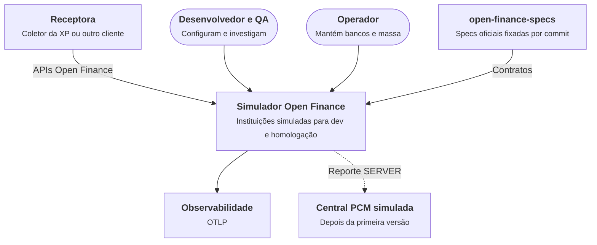

# C1 — Contexto

Níveis: [C2 — Contêineres](C2-conteineres.md) · [C3 — Componentes](C3-componentes.md)

Mostra quem usa o simulador e com o que ele fala.

A receptora chama o simulador como chamaria uma instituição real ([PR07](../../00-visao-geral/premissas.md#pr07)).
