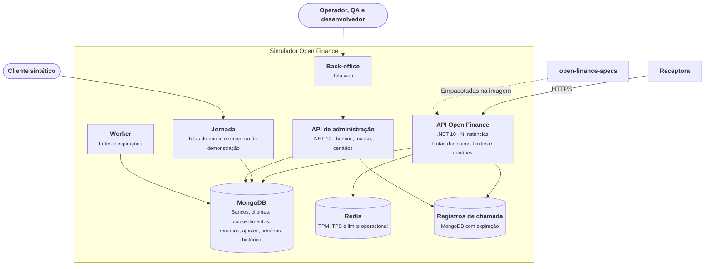

# C2 — Contêineres

Níveis: [C1 — Contexto](C1-contexto.md) · [C3 — Componentes](C3-componentes.md)

| Contêiner | Por quê |
|---|---|
| API Open Finance | Separada para escalar sozinha na carga e isolar o caminho quente |
| Jornada | Tem telas e sessão, com ciclo diferente da API |
| API de administração | Fica em endereço separado ([RN71](../../01-requisitos/regras-de-negocio.md#rn71)) |
| Worker | Lotes longos e expirações não podem depender de uma chamada |
| MongoDB | Estado ([ADR-003](../../05-adr/ADR-003-mongodb-e-redis.md)) |
| Redis | Contadores por minuto e por mês, compartilhados entre as instâncias |

Na primeira versão, API, jornada e administração podem ser um único processo com módulos separados ([ADR-007](../../05-adr/ADR-007-arquitetura-e-endereco.md)).
