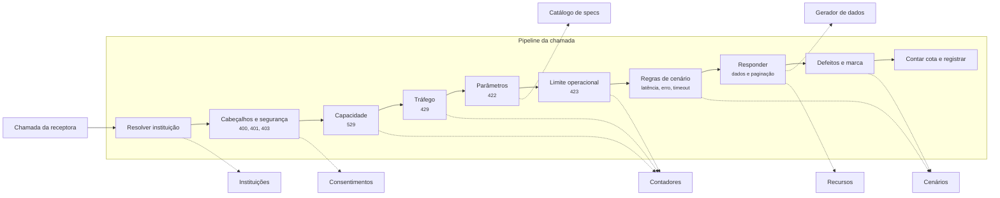

# C3 — Componentes

Níveis: [C1 — Contexto](C1-contexto.md) · [C2 — Contêineres](C2-conteineres.md)

Mostra os módulos e o caminho de uma chamada.

| Módulo | Responsabilidade |
|---|---|
| Catálogo de specs | Lê as specs fixadas, publica rotas, classes e schemas |
| Instituições | Bancos, perfis, configuração e histórico |
| Massa | Clientes, lotes, perfis de dados e distribuição |
| Gerador de dados | Semente, mundo virtual, ajustes e coerência |
| Consentimentos | Máquina de estados, permissões e renovação |
| Jornada | Sessão, login, confirmação e alçadas |
| Recursos | Estados, preparação e seleção |
| Limites | TPM, TPS e limite operacional |
| Cenários | Regras, defeitos e anomalias |
| Marcação | Ambiente e natureza |
| Segurança | Modos simples e FAPI |
| Registros | Chamadas e investigação |

Cada etapa é uma porta testável sozinha. A ordem segue [RN39](../../01-requisitos/regras-de-negocio.md#rn39).
