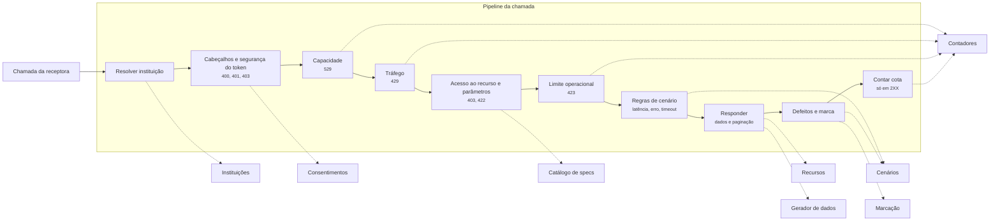

# C3 — Componentes

Níveis: [C1 — Contexto](C1-contexto.md) · [C2 — Contêineres](C2-conteineres.md)

Mostra os módulos e o caminho de uma chamada.

| Módulo | Responsabilidade |
|---|---|
| Catálogo de specs | Lê as specs fixadas, publica rotas, classes e schemas |
| Instituições | Bancos, perfis, configuração e histórico |
| Massa | Clientes, lotes, perfis de dados e distribuição |
| Gerador de dados | Semente, mundo virtual, ajustes e coerência |
| Consentimentos | Criação no painel, máquina de estados, permissões, alçadas e renovação |
| Recursos | Estados, preparação e seleção |
| Limites | TPM, TPS e limite operacional |
| Cenários | Regras, defeitos e anomalias |
| Marcação | Ambiente e natureza |
| Segurança | Modo simples |

Cada etapa é uma porta testável sozinha. A ordem segue [RN39](../../01-requisitos/regras-de-negocio.md#rn39). A cota é contada depois da resposta, só em 2XX ([ADR-008](../../05-adr/ADR-008-pipeline-de-avaliacao.md)).

Não há módulo de registro de chamadas: o simulador só responde, e quem registra e investiga é a aplicação que consome ([RN18](../../01-requisitos/regras-de-negocio.md#rn18)). A observabilidade cobre só a saúde do simulador ([RNF09](../../01-requisitos/requisitos.md#rnf09)).
