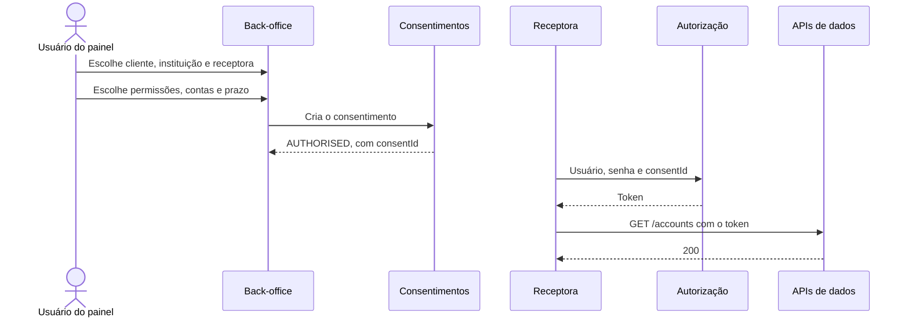

# 01 — Consentimento no painel

Criação pelo menu ([UC10](../../01-requisitos/casos-de-uso/README.md#uc10)), seguida da primeira chamada da receptora ([UC25](../../01-requisitos/casos-de-uso/README.md#uc25)).

